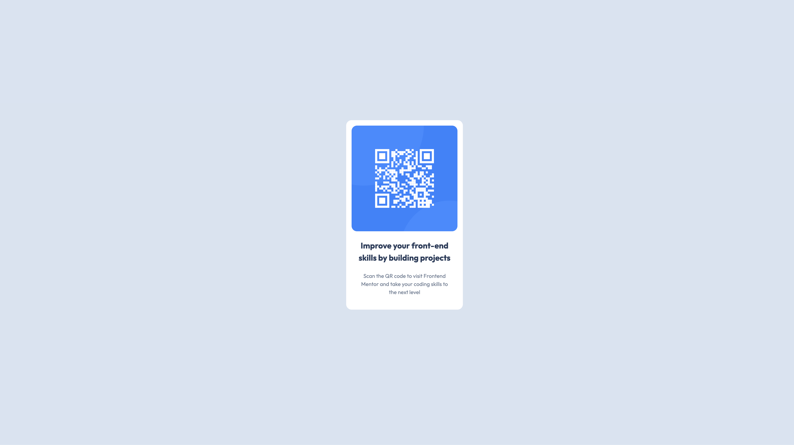

# QR Code Component

## Overview

This is my solution to Frontend Mentor QR code component.

### Screenshot

- Solution URL: [GitHub Repository](https://github.com/piyush-kaushik24/qr-code-component)
- Live Site URL: [Live Site](https://piyush-kaushik24.github.io/qr-code-component/)

## My process

### Built with

- Semantic HTML5 markup
- CSS3
- Flexbox
- Mobile-first workflow

### What I learned

- How to structure a page using semantic HTML.
- How to make responsive layouts.
- How to center a card using Flexbox properties like `justify-content` and `align-items`.
- Learned about the importance of mobile-first approach in responsive design as it becomes very difficult to go from desktop to mobile.
- Learned the importance of `min-height: 100vh` to center content vertically in the viewport.

### Continued development

- Further improve my responsive design skills.
- Become more confident in choosing the right CSS properties for different layouts.
- Practice building responsive layouts with different CSS techniques.

### Useful resources

- Frontend Mentor
- MDN Web Docs

### AI Collaboration

I used ChatGPT as a learning assistant to understand CSS concepts, debug layout issues, and review my approach.

## Author

- Github - [piyush-kaushik24](https://github.com/piyush-kaushik24)
- Frontend Mentor - [@piyush-kaushik24](https://www.frontendmentor.io/profile/piyush-kaushik24)
